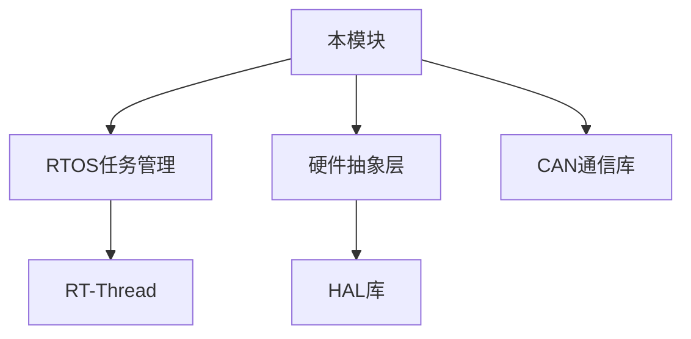

## UI模块概览
| 项目 | 说明 |
|------|------|
| **模块名称** | [UI绘制] |
| **版本** | v1.0.0 |
| **维护者** | [侯臣臣] |
| **最后更新** | 2025-10-14 |

### 功能描述
用于绘制操作手UI界面，辅助操作手了解实时机器人状态信息，帮助其更好做出决策

## 调试依赖
### 必需硬件
| 硬件组件 | 型号/规格 | 备注 |
|----------|-----------|------|
| 遥控器 | 无 | 无 |
| 图传 | 无 | 无 |
### 必需软件
| 软件名称 | 型号/规格 | 备注 |
|----------|-----------|------|
| RoboMasterClient | 11.0.1.128 |客户端|
| DJI Phantom 4 Drivers_1.2 | 1.2 | 遥控器驱动 |
### 可选软件
| 软件名称 | 型号/规格 | 备注 |
|----------|-----------|------|
|          |            | 服务器搭建 |

## 软件架构

### 模块结构
    UI/
    ├── 底层的发送UI数据包给裁判系统/                     # 通用
    │   ├── drv_send_UI.c
    │   └── drv_send_UI.h
    ├── 实现上层的注册和规划需要发送的UI元素/                 # 通用
    │   ├── drv_draw_UI.c
    │   ├── drv_draw_UI.h
    ├── 根据不同兵种操作手需求，对应绘制相关的UI组件/               # 按需
    │   ├──  app_UI.c
    │   └──  app_UI.h
    └── UI绘制相关参数/               # 待调试
        └── CustomUI_GraphParameters.h

### 依赖关系

## 快速开始
### 环境要求
- 编译器: GCC ARM Embedded 10.3
- 构建系统: Makefile/CMake
- 调试器: J-Link/DAP-Link
- 目标平台: [硬件平台名称]
### 集成步骤
1. 添加源文件
    1. 在Makefile中添加
    - SRCS += modules/your_module/src/*.c
    - INCLUDES += -Imodules/your_module/inc
2. 初始化配置

```c  
// 在main.c中初始化
#include "app_UI.h"

int main(void) {
    if (UI_Init() != RT_EOK)
        Robot_Chassis_Reset(RT_TRUE);
    return RT_EOK;
}
```
3. 编译验证
- make clean
- make all
## API参考
### 核心函数
```c
/**
 * @brief 初始化模块
 * @param config 配置参数结构体指针
 * @return 成功返回0，失败返回错误码
 */
int32_t module_init(const module_config_t *config);

/**
 * @brief 启动模块运行
 * @param timeout_ms 启动超时时间(毫秒)
 * @return 启动状态
 */
module_status_t module_start(uint32_t timeout_ms);
```
### 数据类型
```c
/**
 * 模块配置结构体
 */
typedef struct {
    uint32_t sample_rate;    // 采样率(Hz)
    float threshold;         // 动作阈值
    bool enable_filter;      // 滤波器使能
} module_config_t;

/**
 * 模块状态枚举
 */
typedef enum {
    MODULE_IDLE = 0,         // 空闲状态
    MODULE_RUNNING,          // 运行中
    MODULE_ERROR,            // 错误状态
} module_status_t;
```
### 配置说明
- 编译时配置
    在 module_config.h 中：
```c
// 模块调试开关
#define MODULE_DEBUG_ENABLE      1

// 缓冲区大小配置
#define DATA_BUFFER_SIZE         1024

// 超时时间配置(毫秒)
#define INIT_TIMEOUT_MS          5000
#define RESPONSE_TIMEOUT_MS      1000
```
- 运行时配置
    通过结构体配置：
```c
module_config_t config = {
    .sample_rate = 1000,     // 1kHz采样
    .threshold = 2.5f,       // 2.5单位阈值
    .enable_filter = true,   // 启用滤波器
};
```
### 测试验证
- 单元测试
```c
// tests/unit_test.c
void test_module_init(void) {
    module_config_t config = {0};
    TEST_ASSERT_EQUAL(0, module_init(&config));
}

void test_module_data_processing(void) {
    // 测试数据处理功能
    TEST_ASSERT_EQUAL(EXPECTED, actual_result);
}
```
- 硬件在环测试
  - 运行硬件测试
```c
make test-hardware
./test_runner --device /dev/ttyACM0
```


# 版本历史
| 版本 | 日期 | 变更说明 | 测试状态 |
|------|-----|----------|---------|
|v1.0.0|2025-10-18|初始版本|✅ 通过|
|v1.0.1|2024-01-20|修复内存泄漏|✅ 通过|
|v1.1.0|2024-02-01|新增滤波算法|🟡 测试中|
# 常见问题
- Q: 模块初始化失败怎么办？
-     A: 检查硬件连接，确认配置参数在有效范围内。
- Q: 数据输出异常如何排查？
-     A: 启用调试模式，查看数据流日志。