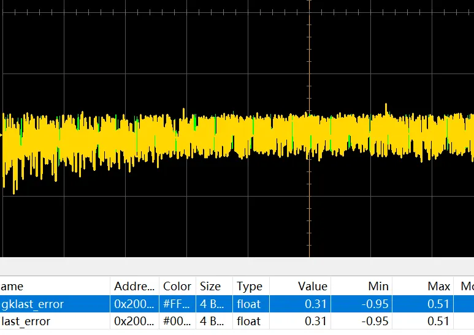
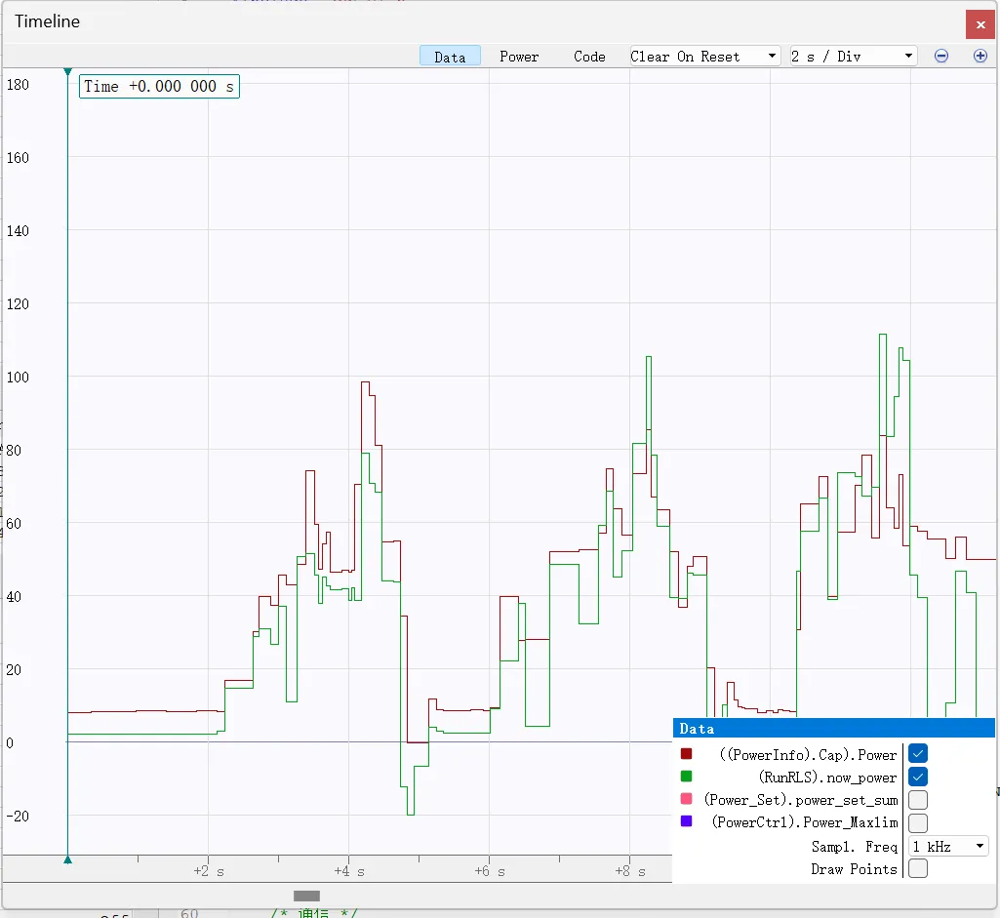

# 底盘功率建模、参数辨识与控制分配理论文档

> **适用对象**：RoboMaster 竞赛底盘功率控制模块 `suprCap3`
> **核心方法**：基于物理建模的功率估计 + 递归最小二乘在线参数辨识 + 置信度加权扭矩反解

---

## 一、电机功率建模

### 1.1 直流母线功率

电机的输入总功率 $P_{in}$ 由直流母线电压 $U_{DC}$ 与电流 $I_{DC}$ 唯一确定：

$$P_{in} = U_{DC} \cdot I_{DC}$$

这是系统可观测的宏观量，作为功率闭环的反馈基准。

---

### 1.2 FOC 框架下的电磁功率分解

在磁场定向控制（Field-Oriented Control, FOC）框架下，三相交流量经 Clarke 变换与 Park 变换映射至同步旋转 $d$-$q$ 坐标系。在该坐标系下，有功功率 $P_e$ 可表示为：

$$P_e = \boldsymbol{U}^{\top}\boldsymbol{I} = U_q I_q + U_d I_d$$

采用 $I_d = 0$ 的磁场定向控制策略（即最大转矩电流比，MTPA 在表贴式永磁同步电机的退化形式），电磁功率简化为：

$$P_e = U_q I_q$$

---

### 1.3 $q$ 轴电压方程与功率展开

根据永磁同步电机（PMSM）的 $q$ 轴电压方程：

$$U_q = K_e\omega_m + R I_q + L_q\frac{dI_q}{dt}$$

代入功率表达式，展开得：

$$\begin{aligned}
P_e &= U_q I_q = \left(K_e\omega_m + RI_q + L_q\frac{dI_q}{dt}\right)I_q \\[6pt]
    &= \underbrace{K_e I_q \omega_m}_{T_e \omega_m} + \underbrace{I_q^2 R}_{P_{\text{copper}}} + \underbrace{L_q I_q \frac{dI_q}{dt}}_{\frac{d}{dt}\!\left(\frac{1}{2}L_q I_q^2\right) = \dot{W}_L}
\end{aligned}$$

各项物理意义如下：

| 项 | 物理含义 | 备注 |
|---|---|---|
| $T_e \omega_m = K_e I_q \omega_m$ | 电磁转换功率（机械端输出） | 有效功率 |
| $I_q^2 R$ | 铜损（绕组焦耳热） | $P_{\text{copper}} \geq 0$ |
| $\dot{W}_L = \frac{d}{dt}\!\left(\frac{L_q}{2}I_q^2\right)$ | 电感磁场储能变化率 | 稳态或周期均值为零 |

---

### 1.4 附加损耗建模

实际系统中还存在以下无法忽视的损耗项：

- **静态功耗** $P_0$：电调逻辑电路、传感器及电机待机时的基础能量消耗，与运行状态近似无关；
- **铁损** $P_{\text{iron}}$：包含磁滞损耗（$P_{\text{hyst}} \propto \omega_m$）和涡流损耗（$P_{\text{eddy}} \propto \omega_m^2$）；
- **机械摩擦损耗**：主要为粘性摩擦（$\propto \omega_m$）与库伦摩擦（$\propto \text{sgn}(\omega_m)$，常数近似）。

综合以上，额外损耗可统一建模为：

$$P_{\text{loss,extra}} = k_0 + k_1|\omega_m| + k_2\omega_m^2$$

---

### 1.5 宏观量替换：从电量到机械量

为便于工程实现，将微观电量（电流、电压）转换为可观测宏观机械量（扭矩、转速）：

**扭矩-电流关系**（$I_d = 0$ 时）：

$$\tau = K_t I_q \implies I_q = \frac{\tau}{K_t}$$

**铜损项变换**：

$$P_{\text{copper}} = I_q^2 R = \frac{R}{K_t^2}\tau^2 \triangleq k_2 \tau^2, \quad k_2 = \frac{R}{K_t^2}$$

**机械输出功率**：

$$P_m = \tau \cdot \omega_m$$

在工程实践中，为保证模型简洁且参数可辨识性良好，将铁损与静态功耗合并，并将高阶项线性化处理：

$$P_{\text{other}} \approx k_1|\omega| + c$$

---

### 1.6 单电机输入功率模型（最终形式）

综合上述推导，单个电机输入总功率的参数化模型为：

$$\boxed{P_{in} = \underbrace{\tau\omega}_{P_m} + \underbrace{k_2\tau^2}_{P_{\text{copper}}} + \underbrace{k_1|\omega|}_{P_{\text{iron+fric}}} + \underbrace{c}_{P_{\text{static}}}}$$

**参数物理对应表**：

| 符号 | 物理含义 | 理论来源 |
|---|---|---|
| $P_m = \tau\omega$ | 输出机械功率 | 电磁转换项 $T_e\omega_m$ |
| $k_2\tau^2$ | 铜损 | $k_2 = R/K_t^2$，绕组焦耳热 |
| $k_1\|\omega\|$ | 铁损与粘性摩擦合并项 | 磁滞损耗线性化 |
| $c$ | 静态功耗 | 电调电路与传感器基础消耗 |

---

## 二、底盘综合功率模型

对于搭载 $n$ 个驱动电机的底盘（标准 Mecanum 四轮底盘，$n=4$），各电机功率叠加，得底盘总功率模型：

$$\boxed{P_{\text{chassis}} = \sum_{i=1}^{n}\tau_i\omega_i + k_2\sum_{i=1}^{n}\tau_i^2 + k_1\sum_{i=1}^{n}|\omega_i| + k_3}$$

其中 $k_3 = \sum_{i=1}^{n}c_i$ 为底盘整体静态功耗，由裁判系统静止时的反馈功率直接标定，无需参与在线辨识。

---

## 三、递归最小二乘参数辨识（RLS）

### 3.1 算法动机

功率模型中的 $k_1$、$k_2$ 依赖于具体电机与电调的物理参数（绕组电阻 $R$、力矩常数 $K_t$ 等），这些参数因个体差异、温漂及老化效应而在不同底盘和运行工况下存在显著偏差。传统离线标定方式需要为每个底盘单独测量，工程成本高且适应性差。

递归最小二乘法（Recursive Least Squares, RLS）可实现**运行时在线自适应辨识**，无需额外标定流程，大幅提升模块的跨平台适用性。

---

### 3.2 问题建模

定义观测量 $y$ 与特征向量 $\boldsymbol{\phi}$：

$$y_t = P_{\text{meas},t} - \sum_{i=1}^{n}\tau_i\omega_i \bigg|_t - k_3$$

$$\boldsymbol{\phi}_t = \begin{bmatrix} \displaystyle\sum_{i=1}^{n}|\omega_i| \\[6pt] \displaystyle\sum_{i=1}^{n}\tau_i^2 \end{bmatrix}_t, \quad \boldsymbol{\theta} = \begin{bmatrix} k_1 \\ k_2 \end{bmatrix}$$

其中 $P_{\text{meas}}$ 为超级电容模块实测功率，则线性回归模型为：

$$y_t = \boldsymbol{\phi}_t^{\top}\boldsymbol{\theta} + \varepsilon_t$$

$\varepsilon_t$ 为测量噪声，假设其为零均值白噪声，方差为 $\sigma^2$。

---

### 3.3 RLS 递推推导

**批量最小二乘**的目标为最小化累计加权残差平方和：

$$\hat{\boldsymbol{\theta}}_t = \arg\min_{\boldsymbol{\theta}} \sum_{k=1}^{t} \lambda^{t-k}\left(y_k - \boldsymbol{\phi}_k^{\top}\boldsymbol{\theta}\right)^2$$

其中 $\lambda \in (0,1]$ 为**遗忘因子**（Forgetting Factor），控制历史数据权重的指数衰减速率——$\lambda$ 越小，算法对参数时变的跟踪越灵敏，但噪声敏感性越高。

定义加权信息矩阵（Gram Matrix）：

$$\boldsymbol{P}_t^{-1} = \sum_{k=1}^{t}\lambda^{t-k}\boldsymbol{\phi}_k\boldsymbol{\phi}_k^{\top}$$

利用矩阵求逆引理（Sherman-Morrison-Woodbury 公式），可将批量求解转化为如下**递推形式**：

**Step 1：卡尔曼增益计算**

$$\boldsymbol{K}_t = \frac{\boldsymbol{P}_{t-1}\boldsymbol{\phi}_t}{\lambda + \boldsymbol{\phi}_t^{\top}\boldsymbol{P}_{t-1}\boldsymbol{\phi}_t}$$

**Step 2：参数更新（新息修正）**

$$\hat{\boldsymbol{\theta}}_t = \hat{\boldsymbol{\theta}}_{t-1} + \boldsymbol{K}_t\underbrace{\left(y_t - \boldsymbol{\phi}_t^{\top}\hat{\boldsymbol{\theta}}_{t-1}\right)}_{\text{新息（Innovation）}}$$

**Step 3：协方差矩阵更新**

$$\boldsymbol{P}_t = \frac{1}{\lambda}\left(\boldsymbol{I} - \boldsymbol{K}_t\boldsymbol{\phi}_t^{\top}\right)\boldsymbol{P}_{t-1}$$

> **注**：RLS 可视为卡尔曼滤波（Kalman Filter）在过程噪声为零、观测噪声为白噪声时的特殊情形。协方差矩阵 $\boldsymbol{P}_t$ 在此扮演参数估计不确定性度量的角色，$\boldsymbol{K}_t$ 即为卡尔曼增益。遗忘因子 $\lambda$ 的引入等效于引入了随机游走过程噪声，赋予算法追踪时变参数的能力。

---

### 3.4 初始化策略与收敛性分析

初始化方案采用如下设置：

$$\hat{\boldsymbol{\theta}}_0 = \boldsymbol{\theta}_{\text{prior}}, \quad \boldsymbol{P}_0 = \alpha \boldsymbol{I}, \quad \alpha \gg 1$$

大初始协方差 $\alpha \boldsymbol{I}$ 表示对先验参数的低置信度，使得算法在初始阶段具有较高的学习率，快速向真值收敛。

**收敛条件**：当特征序列 $\{\boldsymbol{\phi}_t\}$ 满足**持续激励条件**（Persistent Excitation, PE）时，即：

$$\exists\; \alpha_1, \alpha_2 > 0,\; T > 0 \;\text{ s.t. }\; \alpha_1 \boldsymbol{I} \preceq \sum_{k=t}^{t+T}\boldsymbol{\phi}_k\boldsymbol{\phi}_k^{\top} \preceq \alpha_2 \boldsymbol{I}, \quad \forall t$$

RLS 估计量以指数速率收敛至真值，收敛速率正比于最小激励特征值 $\alpha_1$。

---

### 3.5 单电机验证

对单个 GM6020 电机进行在线 RLS 参数拟合实验。图中展示了预测功率与超级电容实测功率之间的误差随时间的演变，可观察到：

- 初始阶段误差较大（先验参数偏差），随特征激励积累，误差单调收敛；
- 稳定后残差维持在测量噪声量级，验证了模型结构的正确性与 RLS 算法的有效性。

---

## 四、功率分配策略

### 4.1 置信度加权分配框架

传统功率限制方案直接对所有电机施加统一的功率衰减系数，导致高误差通道（执行滞后的电机）与低误差通道接受相同的功率削减，降低了底盘的跟随性能。

参考港科大开源方案，引入**置信度变量** $\rho_i$ 对各通道误差大小进行归一化标定：

$$\rho_i = f(e_i) = \begin{cases} 1, & |e_i| \leq e_{\min} \\ \dfrac{e_{\max} - |e_i|}{e_{\max} - e_{\min}}, & e_{\min} < |e_i| < e_{\max} \\ 0, & |e_i| \geq e_{\max} \end{cases}$$

功率分配原则：
- **误差小**（$\rho_i \approx 1$）：近似等比缩放，保留动态响应；
- **误差大**（$\rho_i \approx 0$）：按误差比例削减，优先保障跟随性；
- **中间区域**：置信度与分配功率之间呈线性插值关系。

每个通道分配的目标功率为：

$$P_i^* = \bar{P} \cdot \rho_i + P_{\min} \cdot (1 - \rho_i)$$

其中 $\bar{P}$ 为均匀分配功率，$P_{\min}$ 为最小维持功率。

---

## 五、扭矩反解

### 5.1 基本假设

给定底盘每个电机分配的目标功率 $P_i^*$，需反解对应的扭矩指令 $\tau_i$。反解基于以下工程假设：

1. **线性力矩-电流假设**：无刷电机扭矩与 $q$ 轴电流严格成正比，$\tau = K_t I_q$（忽略磁路饱和）；
2. **力矩环带宽假设**：力矩内环闭环带宽远高于控制主循环频率（$f_{\tau} > 1\text{ kHz}$），故在控制周期内近似有 $\tau_{\text{cur}} \approx \tau_{\text{cmd}}$；
3. **转速慢变假设**：在单个控制周期（$\Delta t = 1\text{ ms}$）内，实际角速度 $\omega_i$ 相对力矩变化量足够缓慢，可视为常数；
4. **静态损耗均分假设**：各电机静态损耗近似相等，$c_i \approx k_3 / n$；
5. **高阶项忽略假设**：铁损与摩擦中关于 $|\omega|$ 的一次项相比铜损与机械功率项，在正常运行区间可忽略（此处为简化反解，非建模忽略）。

---

### 5.2 扭矩-功率一元二次方程

将上述假设代入单电机功率模型，对第 $i$ 个电机建立扭矩反解方程：

$$k_2\tau_i^2 + \omega_i\tau_i + \left(k_1|\omega_i| + \frac{k_3}{n} - P_i^*\right) = 0$$

令：

$$A = k_2, \quad B = \omega_i, \quad C = k_1|\omega_i| + \frac{k_3}{n} - P_i^*$$

判别式：

$$\Delta = B^2 - 4AC = \omega_i^2 - 4k_2\left(k_1|\omega_i| + \frac{k_3}{n} - P_i^*\right)$$

---

### 5.3 解的分类讨论

**情形一：$\Delta < 0$**

方程无实数解，表明在当前转速下，不存在任何扭矩能使该电机恰好消耗目标功率（目标功率超出电机当前工况能力范围）。取功率最接近目标的近似最优解（抛物线顶点）：

$$\tau_i^* = -\frac{B}{2A} = -\frac{\omega_i}{2k_2}$$

**情形二：$\Delta \geq 0$**

方程存在两实数根，均对应电机消耗功率为 $P_i^*$ 的工作点。为确保功率控制不改变底盘的运动方向意图，取与原 PID 控制输出 $\tau_{\text{PID},i}$ 同号的根：

- 若 $\tau_{\text{PID},i} \geq 0$：

$$\tau_i^* = \frac{-\omega_i + \sqrt{\Delta}}{2k_2}$$

- 若 $\tau_{\text{PID},i} < 0$：

$$\tau_i^* = \frac{-\omega_i - \sqrt{\Delta}}{2k_2}$$

---

## 六、负功率与刹车工况分析

### 6.1 负功率的物理本质

当电机扭矩方向与转速方向相反时（制动工况），电机工作于发电机模式，向母线回馈能量，表现为负功率：

$$P_i = \tau_i\omega_i + k_2\tau_i^2 + k_1|\omega_i| + c$$

当 $\tau_i\omega_i < 0$ 且 $|\tau_i\omega_i|$ 足够大时，$P_i < 0$。

### 6.2 裁判系统处理规则与控制含义

经实测，RoboMaster 裁判系统对负功率按零功率处理（不累计到功率缓冲中）。因此，**当底盘出现负功率时，无需施加功率限制**，可令电机自由制动。

> **重要辨析**：扭矩与速度方向相反是出现负功率的**必要条件**，而非充分条件。在轻度制动工况下（铜损与静态损耗大于制动功率），$P_i$ 仍可能为正值，此时仍需参与功率限制。

### 6.3 刹车工况的控制局限性

若在功率限制激活期间，某电机处于制动但呈正功率状态，系统仍将对其进行功率削减，可能导致：

- **刹车距离增大**：制动扭矩被限幅，无法在期望距离内停车；
- **停止抖动**：功率控制与速度控制相互耦合导致周期性振荡。

此类现象本质上反映了**机器人在当前功率预算下不支持该运动速度的快速制动需求**，应从控制源头降低最大速度设定值，而非试图在功率控制层面解决。

---

## 七、实测验证

图中对比了超级电容模块实测底盘总功率曲线与 RLS 辨识参数后模型预测的功率曲线。结果表明：

- **稳态跟随精度高**：两曲线在正常行驶段高度重合，模型误差维持在 $\pm 3\text{ W}$ 以内；
- **制动段负功率现象符合预期**：刹车阶段出现负功率谷值，与功率模型的物理预测一致；
- **动态响应捕捉准确**：急加速段的功率尖峰波形被模型准确复现，验证了铜损项 $k_2\tau^2$ 的非线性建模的必要性。

综上，本方案实现了**全自动在线参数辨识 + 物理一致性功率模型 + 最优扭矩反解**的闭环功率控制架构，无需人工调参，具备良好的跨平台移植性与工程鲁棒性。
